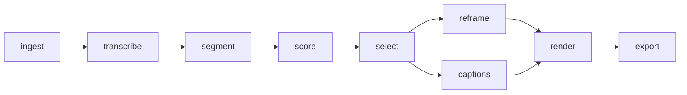

# Architecture

OpenClip is a local-first, contract-first pipeline for turning a source video into selected vertical clips. The v0.1 product supports English-language media only.

## Package responsibilities

| Package | Responsibility |
| --- | --- |
| `core` | Pydantic contracts, settings, errors, and stage interfaces. |
| `ingest` | Safely acquire and inspect a local file or explicitly requested URL. |
| `transcribe` | Generate word-level English transcripts. |
| `analyze` | Segment, score, and select candidate moments. |
| `reframe` | Calculate smooth 9:16 crop paths. |
| `captions` | Build ASS subtitle documents from transcripts and presets. |
| `render` | Invoke FFmpeg with argument lists to produce clips. |
| `pipeline` | Persist jobs and orchestrate sequential, cancellable stages. |
| `api` | Expose the local HTTP contract. |
| `cli` | Make every pipeline stage usable without the web UI. |

## Highlight scoring

`find_candidates` builds sentence-aligned windows of `min_clip_seconds`–`max_clip_seconds`, prefers boundaries at pauses ≥ 0.4 s and topic shifts (pure-Python bag-of-words cosine between adjacent blocks), then scores each window 0–100 with `HeuristicWeights` in `analyze/scoring.py`:

| Component | Weight | Meaning |
| --- | --- | --- |
| `hook` | 30 | Opening-grab rules on the first ~3 s (question, numbers, strong claims, second person, contrast; filler/pronoun/greeting penalties). |
| `speech_rate` | 15 | Triangular score peaking at ~3 words/second. |
| `audio_energy` | 10 | Per-second RMS of `audio.wav`, normalized by the 95th percentile. |
| `question` | 5 | Scaled by question count in the window. |
| `scene_change` | 5 | Scaled by ffmpeg scene-cut count (2 fps, threshold 0.3). |
| `boundary` | 10 | Sentence alignment + edge pauses + topic-shift quality. |
| `duration` | 8 | Length preference: 0 below 30 s, bonus for 30–60 s sentence-aligned windows, mild penalty above ~75 s. |
| `silence_penalty` | 10 | Longest internal word gap beyond ~1.5 s. |
| `filler_penalty` | 10 | Density of filler words ("um", "like", "basically"…). |

The optional LLM judge rescores only the top 12 heuristic candidates; final score is `0.6·llm + 0.4·heuristic` when it answers, heuristic-only otherwise.

## Reframing

`compute_crop_path(media, clip, layout)` samples the clip at ~4 fps and 640 px width through FFmpeg rawvideo pipes (one frame in memory at a time), detects faces with YuNet (`face_detection_yunet_2023mar.onnx`, OpenCV Zoo, MIT; downloaded once into the data dir `models/` with a SHA-256 check), and tracks identities by nearest-centroid matching with short dropout tolerance. The main subject is chosen by area × confidence × persistence and switched only after another face dominates for ≥ 1.5 s (hysteresis). The 9:16 crop spans the full source height; its horizontal centre follows the subject through a ±8 % dead zone, a low-pass filter and a 0.35 crop-widths/s pan limit, snapping instantly at detected scene cuts. The path is RDP-simplified to ≤ ~40 keyframes/minute and always covers `t=0` and the clip end. Layouts: `fill` (subject-following crop, centred fallback), `fit` (single full-frame keyframe; Step 7 renders it over a blurred copy), `auto` (fill only when faces appear in ≥ 60 % of samples, else fit, with the reason logged). Sources already 9:16 or taller than wide pass through as full-frame `fill`. Without the `vision` extra the stage degrades to `fit`/centred crops; the CLI reports a clear error.

## Pipeline orchestration

`pipeline/orchestrator.py` chains `ingest -> transcribe -> analyze (segment/score/select) -> reframe -> captions -> render -> export`. Each stage maps to a `Stage` enum value and owns a slice of the 0-1 job progress: ingest 0.10, transcribe 0.25, segment 0.05, score 0.05, select 0.05, reframe 0.10, captions 0.05, render 0.30, export 0.05. Per-clip work (reframe, captions, render) runs sequentially inside the reframe/captions/render spans; `clip_ready` is emitted as each clip finishes and one clip's failure is recorded in the job message without killing the others.

Artifacts live in `<data_dir>/jobs/<job_id>/` (`media.json`, `transcript.json`, `clips.json`, `crop-<clip>.json`, `captions/<clip>.ass`, `clips/<clip>/` outputs, `results.json`); uploads live in `<data_dir>/uploads/`. Stage caches are keyed by input hash plus parameters (the existing ingest/transcribe caches plus the orchestrator's own stage markers), so an interrupted job resumes at the first missing stage; jobs left `running` at startup are marked `failed` with code `interrupted` and can be resumed. `pipeline/queue.py` runs a single FIFO worker thread with per-job cancellation events feeding an SSE event bus; `pipeline/store.py` persists jobs in SQLite (`<data_dir>/openclip.db`).

## Rendering

`render_clip(media, clip, crop, ass_path, out_path, cfg)` produces 1080x1920 H.264/AAC-128k MP4 (`+faststart`, yuv420p, source fps capped at 30). `fill` crops follow the `CropPath` keyframes through a piecewise-linear FFmpeg `crop` `t` expression, then `scale=1080:1920`; `fit` scales the frame to 1080 wide centered over a blurred, zoomed copy of itself. Captions are burned with the `subtitles` filter built by `captions/fonts.py` (proper escaping, `fontsdir` limited to real font files). `render_thumbnail` grabs a JPEG at ~30 % into the clip (540x960); `render_preview` produces a 360x640 ultrafast captionless proxy for the browser preview. Encoding uses `detect_encoder()`: a one-time probe (cached in `<data_dir>/encoder.json`) tries `h264_vaapi`/`h264_qsv` via a tiny test encode and keeps hardware encoding only if it beats `libx264 -preset veryfast -crf 21` on this machine; `OPENCLIP_ENCODER=x264|vaapi|qsv|auto` overrides. Loudness is untouched unless the gentle `loudnorm` option is enabled. Progress comes from `-progress pipe:1`; cancellation kills the ffmpeg process and removes partial outputs.

## Resource budget

- The whole pipeline must remain under 3 GB peak RAM on the reference N305 machine.
- Stages run sequentially; Whisper and an LLM are never held in memory together.
- Video is streamed through FFmpeg. Analysis samples at no more than 5 fps and reduced resolution.
- CPU int8 is the default. Hardware encoders are optional; software x264 is the fallback.
- Heavy dependencies are optional extras. At most two heavy processes run concurrently.
- Stage artifacts live in a job directory and are cacheable by input hash and parameters.

## Key decisions

- **SQLite instead of Redis:** one local process needs durable, dependency-free job storage.
- **ASS plus libass instead of a JavaScript renderer:** FFmpeg produces repeatable burned-in captions.
- **YuNet instead of YOLO:** it satisfies the permissive-license requirement for face detection.
- **Apache-2.0:** it keeps the project broadly reusable.
- **Local-first:** no account, telemetry, or mandatory API key is required.
- **Contract-first:** models and OpenAPI are the shared boundary between pipeline, API, and UI work.
