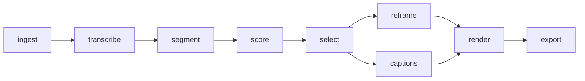

# Architecture

OpenClip is a local-first, contract-first pipeline for turning a source video into selected vertical clips. The v0.1 product supports English-language media only.

## Package responsibilities

| Package | Responsibility |
| --- | --- |
| `core` | Pydantic contracts, settings, errors, and stage interfaces. |
| `ingest` | Safely acquire and inspect a local file or explicitly requested URL. |
| `transcribe` | Generate word-level English transcripts. |
| `analyze` | Segment, score, and select candidate moments. |
| `reframe` | Calculate smooth 9:16 crop paths. |
| `captions` | Build ASS subtitle documents from transcripts and presets. |
| `render` | Invoke FFmpeg with argument lists to produce clips. |
| `pipeline` | Persist jobs and orchestrate sequential, cancellable stages. |
| `api` | Expose the local HTTP contract. |
| `cli` | Make every pipeline stage usable without the web UI. |

## Resource budget

- The whole pipeline must remain under 3 GB peak RAM on the reference N305 machine.
- Stages run sequentially; Whisper and an LLM are never held in memory together.
- Video is streamed through FFmpeg. Analysis samples at no more than 5 fps and reduced resolution.
- CPU int8 is the default. Hardware encoders are optional; software x264 is the fallback.
- Heavy dependencies are optional extras. At most two heavy processes run concurrently.
- Stage artifacts live in a job directory and are cacheable by input hash and parameters.

## Key decisions

- **SQLite instead of Redis:** one local process needs durable, dependency-free job storage.
- **ASS plus libass instead of a JavaScript renderer:** FFmpeg produces repeatable burned-in captions.
- **YuNet instead of YOLO:** it satisfies the permissive-license requirement for face detection.
- **Apache-2.0:** it keeps the project broadly reusable.
- **Local-first:** no account, telemetry, or mandatory API key is required.
- **Contract-first:** models and OpenAPI are the shared boundary between pipeline, API, and UI work.
